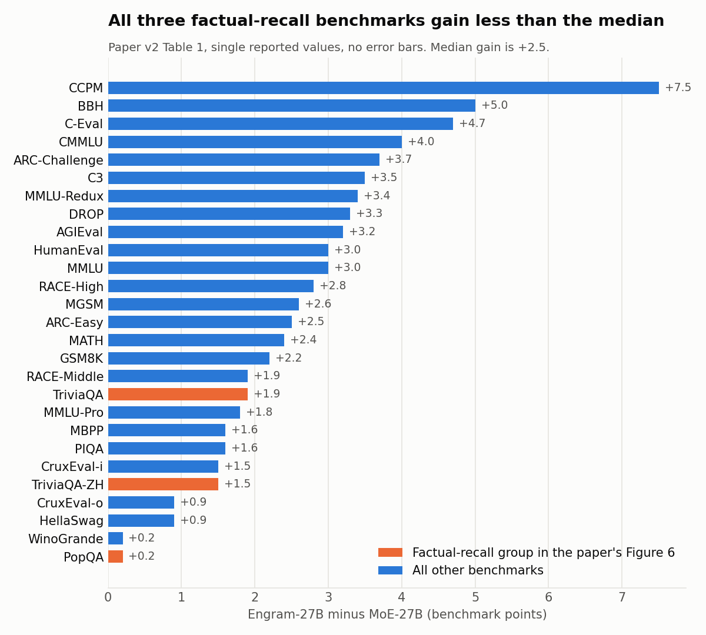
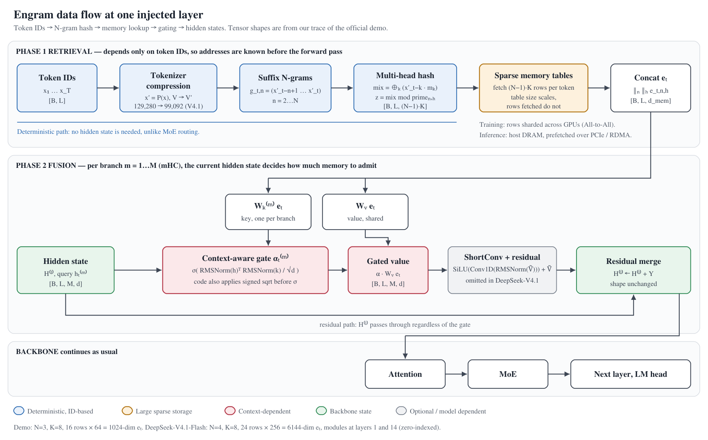
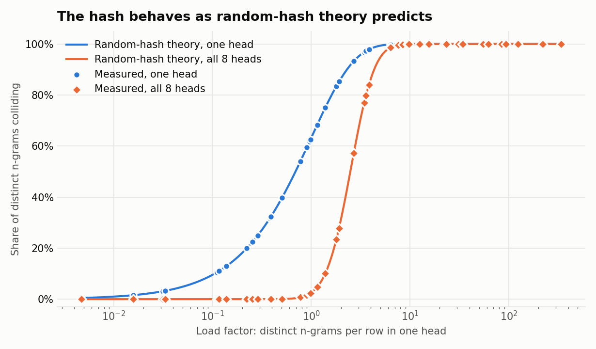
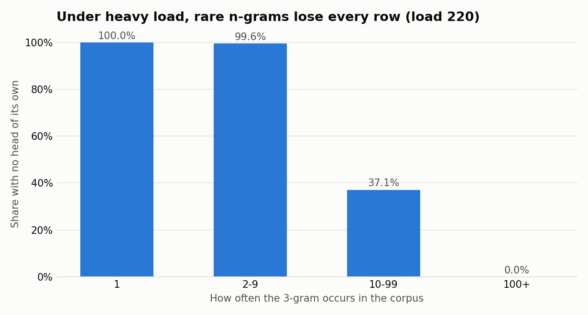

# Engram 論文研讀與技術原理分析

> Issue #277 研究報告｜版本日期 2026-11-06｜論文版本 arXiv:2601.07372v2（2026-07-12）

## 摘要與研究判斷

**Engram 是什麼：** 在 Transformer 的少數層，以「最後幾個 token」為 key 查一張極大的 embedding 表，再由當前 hidden state 決定採納多少。它把容量從「每個 token 要算多少」中分離出來：表可以很大，但每個 token 只取固定數量的 row。

**五項主要判斷：**

1. **架構貢獻成立，而且已進入產品。** 在同參數、同 FLOPs 下，Engram-27B 的 27 項 benchmark 全部優於 MoE-27B（中位數 +2.5 分）。DeepSeek-V4.1-Flash 已實際採用（196B Engram 參數），但移除了 ShortConv，且 RL rollout 階段不放在 host memory。
2. **增益穩定但幅度中等，且報告值未附誤差範圍。** Sparse 架構本身（Dense→MoE）的中位數增益是 +9.5，Engram 是在此之上再加約四分之一。
3. **「Engram 是事實知識主要儲存處」證據不足。** 移除 Engram 後事實類崩跌，但 MATH（36%）與 MGSM（44%）跌幅相近；而加入 Engram 時，事實類增益反而全部低於中位數。較保守的解讀是 backbone 與 Engram 共同適應，移除後才失能。
4. **Engram 不是 RAG 的替代品。** 它沒有來源引用、沒有即時更新路徑，key 也只有 2～4 個 token。對智慧客服，建議維持 RAG 為主；Engram 應視為基礎模型的內建能力，而非知識庫工具。
5. **繁體中文要另外驗證。** 本研究實測：2,171 組繁簡單 token 配對**沒有一組**被 tokenizer compression 合併；同一批文章轉為繁、簡後，繁體 3-gram 出現次數只有 27.0% 落在簡體版也有的 n-gram 上。

**最值得下一步做的實驗：** 在 V4.1 真實權重上關閉 Engram（§5.5 實驗 D），並以繁中資料評估。它成本最低，能同時驗證判斷 3 與 5。

### 證據標記

| 標記 | 意義 |
|---|---|
| 〔論文實測〕 | 論文報告的測量結果，本研究未重現 |
| 〔論文主張〕 | 論文的解讀或提議，未有對應實測 |
| 〔V4.1 官方〕 | DeepSeek-V4.1-Flash 官方技術報告、設定檔或程式碼 |
| 〔本研究實測〕 | 本研究實際執行，可由 `results/` 與 `scripts/` 重現 |
| 〔本研究推論〕 | 本研究的推理，尚未實驗驗證 |
| 〔第三方未驗證〕 | 社群回報，本研究未重現 |

---

## 1. 模型架構與技術背景

### 1.1 Dense、MoE、Engram 的差異

| | Dense Transformer | MoE | Engram（加在 MoE 上） |
|---|---|---|---|
| 擴充方式 | 加寬、加深 | 增加 routed experts | 增加 embedding 表的 row |
| 每 token 啟用 | 全部參數 | shared + top-k experts | 固定數量的 row，加上投影矩陣 |
| 選擇依據 | 無 | **執行時的 hidden state** | **token ID**，執行前即可確定 |
| 適合 | 通用計算 | 依情境而變的動態計算 | 局部、固定、常見的模式 |
| 主要限制 | 容量與算力綁定 | routing 與 expert 通訊 | 只看局部 n-gram，且有 hash 碰撞 |

### 1.2 Conditional Computation 與 Conditional Memory

論文主張語言建模包含兩類工作：組合式推理，以及知識取回。標準 Transformer 沒有內建查表能力，因此要用多層 attention 與 FFN「以計算模擬查表」。論文舉例，模型要到約第 6 層才完整解析出 “Diana, Princess of Wales”。〔論文主張〕

- **Conditional computation（MoE）：** 依內容啟用部分*運算*。
- **Conditional memory（Engram）：** 依內容取回部分*靜態表示*。

### 1.3 Total Parameters、Activated Parameters、FLOPs

論文 §3.1 的定義：

$$P_{\text{sparse}} \triangleq P_{\text{tot}} - P_{\text{act}}, \qquad P_{\text{MoE}}^{(\text{sparse})}=\rho\,P_{\text{sparse}}, \qquad P_{\text{Engram}}=(1-\rho)\,P_{\text{sparse}}$$

- $P_{\text{tot}}$：可訓練參數總量，不含 vocabulary embedding 與 LM head。
- $P_{\text{act}}$：每個 token 啟用的參數量，決定訓練成本（FLOPs）。
- $P_{\text{sparse}}$：未啟用的參數，是可擴充模型規模、又不增加計算的「免費」預算。

**具體例子（V4.1）〔本研究推論，依〔V4.1 官方〕設定計算〕：** 兩個模組共 196.6B 參數，但每個 token 只讀取 2 × 24 × 256 = 12,288 個值，約佔表的 0.000006%。不過 O(1) 只對「表的 row 數」成立：`wkv` 投影矩陣約 1.57 億參數／模組，每個 token 都會使用，成本隨維度增加。

### 1.4 相同參數、相同 FLOPs 的比較

所有模型皆訓練 262B tokens，啟用參數皆為 3.8B（論文 Table 1）。〔論文實測〕

| | Dense-4B | MoE-27B | Engram-27B | Engram-40B |
|---|---:|---:|---:|---:|
| 總參數 | 4.1B | 26.7B | 26.7B | 39.5B |
| Routed experts（top-6） | – | 72 | 55 | 55 |
| Engram 參數 | – | – | 5.7B | 18.5B |
| Validation loss | 1.768 | 1.634 | **1.622** | 1.610 |
| Pile loss | 2.091 | 1.960 | **1.950** | 1.942 |
| MMLU | 48.6 | 57.4 | **60.4** | 60.6 |
| CMMLU | 47.9 | 57.9 | **61.9** | 63.4 |
| TriviaQA | 33.0 | 48.8 | **50.7** | 51.8 |
| BBH | 42.8 | 50.9 | **55.9** | 57.5 |
| CCPM | 72.2 | 79.6 | **87.1** | 87.7 |
| ARC-Challenge | 59.3 | 70.1 | **73.8** | 76.4 |
| HumanEval | 26.8 | 37.8 | **40.8** | 38.4 |
| MATH | 15.2 | 28.3 | **30.7** | 30.6 |

本研究對全部 27 項 benchmark 的整理〔本研究推論，依 Table 1 計算〕：

- Engram-27B vs MoE-27B：**27 項全部為正，中位數 +2.5，平均 +2.62**。
- MoE-27B vs Dense-4B：中位數 +9.5。
- Engram-40B 有 4 項低於 Engram-27B（C3、HumanEval、MBPP、MATH）。論文認為可能是訓練不足，但未驗證。



**長上下文（論文 Table 2）〔論文實測〕：** 論文比較了 Engram 的 41k、46k、50k 步 checkpoint。其中 46k 與 MoE 50k 的預訓練 loss 相同（iso-loss），50k 則是 iso-FLOPs。

| RULER 32k | MoE 50k | Engram 41k | Engram 46k | Engram 50k |
|---|---:|---:|---:|---:|
| Multi-Query NIAH | 84.2 | 89.5 | 97.0 | 97.0 |
| Variable Tracking | 77.0 | 83.2 | 87.2 | 89.0 |
| Single NIAH | 100.0 | 99.6 | 97.6 | 99.3 |
| Common Words | 4.5 | 3.8 | 4.3 | 5.9 |
| QA | 34.5 | 44.0 | 37.5 | 40.5 |

### 1.5 Sparsity Allocation 與最佳配置比例

**實驗設定：** $P_{\text{tot}}/P_{\text{act}}\approx 10$，比較 5.7B（$2\times10^{20}$ FLOPs）與 9.9B（$6\times10^{20}$ FLOPs）兩種規模。〔論文實測〕

**結果：**

- 驗證 loss 對 $\rho$ 呈 U 型。9.9B 模型由 1.7248（ρ=100%）降到 1.7109（ρ≈80%），Δ=0.0139。
- ρ≈40% 時約與純 MoE 打平。
- 最佳點約在 ρ≈75–80%，也就是把 20–25% 的稀疏預算給 Engram。
- 正式模型 Engram-27B 使用 ρ=74.3%。

**本研究判讀〔本研究推論，數值由論文 Figure 3 目測〕：** 應視為**平緩的底部區間**，而非精確最佳值。ρ≈70–95% 的點彼此差距很小，圖上最低點約在 85%，而非文字所述的 75–80%。真正穩健的結論是「純 MoE（ρ=100%）不是最佳，給 Engram 少量預算就有效」。

**記憶體無限擴張（§3.2）〔論文實測〕：** 固定 backbone，將 slots 由 $2.58\times10^5$ 增至 $10^7$，loss 約由 1.788 降至 1.743（Figure 3 目測）。論文稱之為 “strict power law”，但圖的 x 軸取 log、y 軸線性，較接近**對數關係**：記憶體每增加 10 倍，loss 只降約 0.028。〔本研究推論〕

---

## 2. Engram 核心原理

### 2.1 資料流程圖



可編輯向量檔：`figures/engram_dataflow.svg`。圖中的張量形狀來自本研究對官方 Demo 的實際追蹤。〔本研究實測〕

| 步驟 | Demo 實測形狀 |
|---|---|
| Token IDs | `[1, 13]` |
| Hash IDs（2 階 × 8 heads） | `[1, 13, 16]` |
| 取回的 rows | `[1, 13, 16, 64]` |
| 串接後 $e_t$ | `[1, 13, 1024]` |
| Hidden state（4 branches） | `[1, 13, 4, 1024]` |
| Gate | `[1, 13, 4]` |
| 輸出 | `[1, 13, 4, 1024]` |

### 2.2 Vocabulary Compression

**目的：** Tokenizer 為了無損還原，會給語意相同的詞不同 ID（如 `Apple` 與 ` apple`）。壓縮將它們併為同一個 canonical ID，讓相同語意的 n-gram 共用記憶。

$$x'_t=\mathcal{P}(x_t), \qquad g_{t,n}=(x'_{t-n+1},\dots,x'_t)$$

程式實作依序進行 NFKC、NFD、去重音、轉小寫，並正規化空白。

**重現結果〔本研究實測〕：** 詞表壓縮比完全吻合。

| Tokenizer | 原始 | 壓縮後 | 縮減 | 對照 |
|---|---:|---:|---:|---|
| DeepSeek-V3 | 128,815 | 98,627 | 23.44% | 論文 23.43% |
| DeepSeek-V4.1 | 129,280 | 99,092 | 23.35% | 與 V4.1 設定檔完全相同 |

前幾大合併群的大小（163、54、40、35）也與論文 Appendix C 相同。

**但實際語料的效益明顯較小〔本研究實測〕：** 「詞表縮減 23%」不等於「n-gram 種類縮減 23%」，而且中文幾乎不受益。

| Distinct n-gram 種類縮減 | 2-gram | 3-gram | 4-gram |
|---|---:|---:|---:|
| 英文維基 | 17.6% | 6.5% | 2.5% |
| 英文客服（Bitext） | 9.6% | 5.7% | 4.2% |
| 繁中維基 | 4.1% | 1.9% | 0.9% |
| 簡中維基 | 3.7% | 1.7% | 0.7% |

35,346 個含 CJK 的 token 中，沒有任何一個被併入合併群，所以中文的縮減來自其他 token（如標點、數字與拉丁字母）。

### 2.3 N-gram Hash Lookup 與 Multi-Head Hashing

所有 n-gram 的組合空間無法直接存表，因此使用 hash。對每個階數 $n$，用 $K$ 個 head 分別映射到大小為質數的表：

$$z_{t,n,k}=\phi_{n,k}(g_{t,n}),\quad e_{t,n,k}=E_{n,k}[z_{t,n,k}],\quad e_t=\mathop{\Vert}_{n=2}^{N}\mathop{\Vert}_{k=1}^{K}e_{t,n,k}$$

**實際的 hash 比論文描述更簡單。** Demo 與 V4.1 都是先算出同一個值，各 head 只有 modulus（質數）不同〔本研究閱讀程式碼〕：

```text
mix = (x'_t × m0) XOR (x'_{t-1} × m1) XOR (x'_{t-2} × m2) ...
z_head = mix mod prime_head
```

各層的 multipliers 不同，同一層所有 head 共用。這是否損害獨立性，正是實驗 A 檢驗的項目（結果見 §2.4）。

### 2.4 Hash Collision 問題與緩解

論文指出 multi-head 用於緩解碰撞，並由 gating 抑制雜訊，但**沒有提供碰撞量化分析**。Issue #21 也有人詢問表大小的依據，目前無官方回覆。本研究因此先做了實驗 A。

**實驗設定〔本研究實測〕：**

- 語料：英文維基 3,000 萬 tokens、Bitext 客服 367 萬 tokens、繁中與簡中維基各約 1,000 萬 tokens。
- Hash：本研究獨立實作，在隨機 token 上與官方 Demo **全部 16 個 head 完全一致**；V4.1 的壓縮詞表大小與兩層表的 row 數也和設定檔完全相同。

**結果一：hash 品質良好。** 碰撞率與隨機 hash 理論高度吻合；所有語料、階數與表大小下都未發現 8 個 head 完全相同的簽章。共用 `mix` 沒有造成可偵測的相關性。



| 3-gram | 每 head 的 row | 負載 | 單 head 碰撞 | 8 head 全碰撞 | 8 head 都非最高頻（種類佔比） |
|---|---:|---:|---:|---:|---:|
| 英文維基 | 2,262,400 | 6.38 | 99.8% | 98.6% | 6.5% |
| 英文維基 | 16,000,000 | 0.90 | 59.4% | 1.55% | ≈0 |
| 繁中維基 | 2,262,400 | 2.70 | 93.2% | 57.1% | 0.02% |
| 繁中維基 | 16,000,000 | 0.38 | 31.7% | 0.01% | 0 |

**結果二：實際訓練規模下，碰撞很可能是常態，而非例外。** 以 Heaps' law 外推，英文 3-gram 在 262B tokens 約有 $3.9\times10^{10}$ 種，45T tokens 約有 $3.4\times10^{12}$ 種，遠多於 1,600 萬 row。〔本研究推論；由 3,000 萬 token 外推，跨約 4～6 個數量級，只應視為量級參考〕

因此，多個 head 的作用不是「避免碰撞」，而是**讓常見 n-gram 至少能在某些 row 上佔優勢**。

**結果三：負載高時，資源由高頻 n-gram 取得。** 在負載 220 的測試中（英文維基 3-gram、每 head 65,536 row），出現 100 次以上的 n-gram 平均是 7.2/8 個 row 內的最高頻者，只出現 1 次的則完全沒有。



此處「佔位」是指該 n-gram 是某個 row 內語料頻率最高者，僅為代理指標，未量測訓練後的表示品質。

**對領域知識的含意〔本研究推論〕：** 在通用語料上訓練時，罕見的領域術語與產品名稱不容易取得專屬表示。這也呼應實驗 E 需要在領域資料上訓練。

### 2.5 Context-Aware Gating

靜態 embedding 無法區分語境，還可能受 hash 碰撞與一詞多義干擾。Gating 用當前 hidden state 判斷該記憶是否適用：

$$k_t=W_K e_t,\quad v_t=W_V e_t,\quad \alpha_t=\sigma\!\left(\frac{\mathrm{RMSNorm}(h_t)^\top\mathrm{RMSNorm}(k_t)}{\sqrt d}\right),\quad \tilde v_t=\alpha_t v_t$$

**多分支版本（mHC）：** 共用表與 $W_V$，每個 branch 各有 $W_K^{(m)}$。

**論文公式未寫出的細節〔本研究閱讀程式碼〕：** Demo 與 V4.1 都在 sigmoid 之前加了 signed square root，V4.1 註解寫明 “matching the training kernel”。

$$\alpha_t=\sigma\big(\mathrm{sign}(s)\sqrt{\max(|s|,10^{-6})}\big)$$

**Gate 是 scalar，不是 per-dimension：** 每個 token、每個 branch 一個值。論文的視覺化顯示 gate 在實體與慣用語結尾時較高。〔論文實測，定性〕

### 2.6 Short Convolution 與 Residual Connection

$$Y=\mathrm{SiLU}\big(\mathrm{Conv1D}(\mathrm{RMSNorm}(\tilde V))\big)+\tilde V,\qquad H^{(\ell)}\leftarrow H^{(\ell)}+Y$$

- **Short Convolution：** depthwise causal convolution，kernel=4，dilation=最大 N-gram 階數，用於擴大感受野並增加非線性。
- **Residual connection：** 記憶以加法寫入，gate 接近 0 時 hidden state 幾乎不變，訓練較穩定。

**ShortConv 的實際重要性很低：**

| Ablation（3B MoE + 1.6B Engram，參考 val loss 1.768，基線 1.808） | val loss（Figure 5 目測） | 保留的增益 |
|---|---:|---:|
| 無 ShortConv | ≈1.7687 | ≈98% |
| 無 gating | ≈1.7725 | ≈89% |
| 無 token compression | ≈1.7742 | ≈85% |
| 無 multi-branch | ≈1.7745 | ≈84% |
| 單模組插在第 12 層 | ≈1.7825 | ≈64% |

**V4.1 已正式移除 ShortConv**，理由是效能增益不足以支撐推論堆疊增加的複雜度。〔V4.1 官方 §2.4.2〕

**本研究判讀：** 這些元件的確有幫助，但 Engram 的增益主要來自「有這張表」本身。〔本研究推論〕另外，論文稱 convolution 零初始化可「嚴格保留 identity mapping」，但依公式仍有 $\tilde V$ 項，整個模組並非恆等。除非 $W_V$ 也特別初始化，否則此說只適用於 conv 分支。〔本研究推論〕

### 2.7 放置位置

- 單模組掃描中，第 2 層最佳，越深效果越差。〔論文實測〕
- 同樣 1.6B 拆成第 2、6 層兩個模組更好（1.768 vs 1.770）。〔論文實測〕
- 取捨：早放才能減輕底層重建負擔；晚放則 hidden state 較有上下文，也有更長的預取時間。〔論文主張〕

---

## 3. 記憶儲存與運算效率

### 3.1 為何擴大記憶時，每 token lookup 成本仍接近固定

- 每個 token 只做固定次數的 hash 與 row 讀取：$(N-1)\times K$ 個 row／模組。
- 表再大，hash 次數與取回資料量都不變。論文也指出通訊量取決於啟用的 slot 數，而非表的大小。〔論文主張〕

**但「O(1)」是演算法複雜度，不等於固定延遲。**〔本研究推論〕表變大後，CPU cache 與 TLB 的 miss 通常會變多，實際延遲可能仍隨表大小改變。這正是實驗 C 要量測的項目。

### 3.2 CPU DRAM、GPU HBM 與 Prefetching

MoE 的選擇取決於 hidden state，要計算後才知道。Engram 的位址只取決於 token ID，因此可以**提前取資料**，並與前面層的計算重疊，以掩蓋傳輸延遲。

| 階段 | 表的位置 | 機制 | 來源 |
|---|---|---|---|
| 訓練 | 分片於 GPU | All-to-All 收集 row、回傳梯度 | 〔論文主張〕 |
| 訓練（V4.1） | 依 row 分片至專用 process group | 每個 stage 開始前預取；與 vision encoder 重疊 | 〔V4.1 官方 §3.1.3〕 |
| 推論（論文） | Host DRAM | 經 PCIe 非同步預取，與第一個 block 的計算重疊 | 〔論文實測〕 |
| 推論（V4.1） | Host memory | 背景 RDMA 預取 | 〔V4.1 官方 §2.4.2〕 |
| RL rollout（V4.1） | **GPU memory** | 避免 host memory 碎片化導致 OOM | 〔V4.1 官方 §3.1.3〕 |
| 多級快取（HBM/DRAM/NVMe） | 依熱度分層 | 依 Zipf 分布 | 〔論文主張〕，無實測 |

最後兩列值得注意：host offload 並非所有階段都適用；NVMe 分層則只是提議。

**傳輸頻寬應該不是主要瓶頸〔本研究推論〕：** 以 V4.1 每模組每 token 約 6.3 KB、每秒 9,000 token 估算，約 57 MB/s，遠低於 PCIe 的能力。真正的限制更可能是記憶體容量與隨機讀取延遲。V4.1 兩張表估計約 203 GB（假設 FP8 + 每 32 維 1 byte scale），約佔 510 GB 權重的四成。

### 3.3 論文的推論效能與記憶體實驗

**設定：** nano-vLLM、NVIDIA H800、512 條序列、長度 Uniform(100, 1024)；100B Engram 放在第 2 個 block，全部位於 host DRAM。〔論文實測〕

| Backbone | 基線（tok/s） | + 100B Engram（CPU offload） | 下降（本研究計算） |
|---|---:|---:|---:|
| Dense-4B | 9,031.62 | 8,858.28 | 1.92% |
| Dense-8B | 6,315.52 | 6,140.02 | 2.78% |

### 3.4 Zipf 分布與快取可行性

論文以 Zipf 分布主張多級快取可行，但未實測。本研究以前 80% 語料選出熱門 row，測量其在後 20% 的命中率。〔本研究實測〕

| 每 head 1,600 萬 row，取前 1% / 前 10% | 2-gram | 3-gram | 4-gram |
|---|---:|---:|---:|
| 英文維基 | 65.7% / 86.9% | 28.6% / 48.5% | 13.5% / 26.8% |
| 繁中維基 | 60.9% / 81.5% | 22.6% / 39.6% | 10.5% / 22.5% |
| 客服（自身熱門集） | 93.4% / 94.0% | 79.5% / 82.9% | 63.6% / 71.4% |
| 客服（**用英文維基的熱門集**） | 50.4% / 74.5% | **10.8%** / 28.2% | **2.3%** / 13.3% |

**判讀：**

- 2-gram 的快取效益高，但**階數越高效益越低**，而 V4.1 每個 token 都要讀這三階。
- **熱門集依賴工作負載。** 用維基熱門集服務客服流量時，3-gram 命中率由 79.5% 跌到 10.8%。

**限制：** Bitext 是模板式資料，偏斜程度可能偏高；語料遠小於實際訓練規模；這裡只測單一 head 的靜態熱門集。

### 3.5 已驗證與尚未驗證

| 項目 | 狀態 | 說明 |
|---|---|---|
| 100B 表 offload 吞吐下降 <3% | 論文實測 | 僅 Dense backbone、單一 Engram 層 |
| MoE backbone 的 offload 開銷 | **未測** | 論文為避開 Expert Parallel 通訊干擾，刻意用 Dense |
| 兩個模組（第 2、15 層）的開銷 | **未測** | 實際模型配置與實驗不同 |
| p50/p99 延遲、首字延遲 | **未報告** | Table 4 只有吞吐量 |
| HBM vs DRAM 直接比較 | **未測** | 論文無此實驗 |
| NVMe 分層、快取命中率 | **未測（官方）** | 本研究 §3.4 僅為語料模擬 |
| 「完整實作開銷可忽略」 | 論文主張 | 文中用語為 “strongly suggests” |
| 同參數同 FLOPs 增益 | 論文實測 | 單一報告值，無誤差範圍，未見獨立重現 |
| 有效深度增加 | 論文實測＋解讀 | CKA/LogitLens 為相關性證據 |
| Hash 碰撞行為 | 本研究實測 | 僅語料統計；未量測訓練後的影響 |

---

## 4. 與既有技術比較

### 4.1 綜合比較

| 面向 | Engram | MoE | RAG | LoRA | Fine-tuning |
|---|---|---|---|---|---|
| 本質 | 模型內的 n-gram 記憶表 | 模型內的條件式運算 | 模型外的文件檢索 | 低秩權重增量 | 更新模型權重 |
| 檢索或選擇依據 | 最後 2～4 個 token 的 hash | hidden state | Query 與文件相似度或關鍵字 | 無 | 無 |
| Key 的範圍 | 局部、精確 | 完整上下文表示 | 語意，可涵蓋文件層級 | 無 | 無 |
| 更新知識 | 需梯度訓練（見 §4.3） | 重訓 | **更新索引即可** | 再訓練 adapter | 再訓練 |
| 可追溯來源 | 否 | 否 | **是** | 否 | 否 |
| 佔用上下文 | 否 | 否 | 是 | 否 | 否 |
| 額外基礎設施 | 大容量記憶體與預取 | Expert 通訊 | 索引、檢索器、重排序 | 少 | 少 |
| 主要用途 | 提升基礎模型容量 | 提升基礎模型容量 | 動態、可查證的知識 | 風格、任務調整 | 深度領域適應 |

（RAG、LoRA、Fine-tuning 欄為本研究依一般技術特性整理，並非論文的實驗比較。）〔本研究推論〕

### 4.2 Engram 與 RAG

兩者都是「查詢」，但層級完全不同：

| 面向 | Engram | RAG |
|---|---|---|
| 查詢發生時間 | 每個 token，在模型內 | 通常在生成前，每次請求一次或數次 |
| 回傳內容 | 不可讀的向量 | 人可讀、可引用的文字 |
| 知識形成 | 訓練時由梯度寫入 | 文件進入索引 |
| 改寫同義問句 | 只有 n-gram 相同才會命中 | 語意檢索可涵蓋 |
| 失敗情形 | 靜默，難以察覺 | 可檢查檢索結果 |

**兩者可以互補，但目前只有間接證據。** 論文顯示 Engram 改善長上下文表現（RULER），這可能有利於處理 RAG 檢索回來的長文件。不過閱讀理解類在移除 Engram 後仍保有 81–93%，表示基於上下文的任務主要依賴 backbone。〔論文實測〕實際互補效果未經驗證。〔本研究推論〕

### 4.3 Engram Memory 能否獨立更新

**簡答：** 表的儲存可以和 backbone 分開，但其中的知識無法直接編輯。更新需要額外訓練，而且論文沒有驗證此事。

| 問題 | 答案 | 依據 |
|---|---|---|
| 論文是否測試更新？ | **否** | 論文僅描述聯合訓練；論文將 “editable” 用於 REALM、RETRO 等 non-parametric memory，沒有如此描述 Engram |
| 可以直接寫入一筆事實嗎？ | **不行** | Row 是訓練出的向量，且被多個 n-gram 共用，沒有「文字→row 內容」的路徑 |
| 可以凍結 backbone，只訓練表嗎？ | **架構上可行**；第三方有初步報告 | 見下方 ENGRAFT |
| 會影響其他知識嗎？ | **可能** | 每個 row 由多個 n-gram 共用（§2.4） |
| 能否用 Multi-head 降低干擾？ | 部分可以 | 同一 n-gram 的表示分散於多個 row，但每個 row 仍可能共用 |

**第三方證據：ENGRAFT（Issue #26）〔第三方未驗證〕** 在 Qwen3.8-Flash-Next 的 Engram 式表上，只訓練 table rows：

- 100 條虛構事實、841 句測試：精確答對率 **0.841**（基線 0.005），第二個 seed 為 0.873。
- 語言不符時基本無效：以義大利語測試中文 overlay，結果與基礎模型相同。作者表示事實必須以將被詢問的語言及相近措辭寫入。
- 一題涉及兩項事實時，83 題中只有 4 題兩個答案都正確。
- 100 條事實的 collateral KL 為 0.0131，約為作者基準的 4 倍。

使用這份證據時須注意：非同儕審查；作者揭露以 Claude Code 製作（本報告也使用 Claude 撰寫，因此不能視為完全獨立的佐證）；**V4.1 上尚無測量**。本研究也未重現其結果。

### 4.4 與 LoRA / Fine-tuning 的不同用途

| 需求 | 建議 | 原因 |
|---|---|---|
| 產品規格、價格、政策常變動 | RAG | 更新只需重建索引，且可引用來源 |
| 回答風格、格式、語氣 | LoRA 或 fine-tuning | 屬行為調整，Engram 不擅長 |
| 領域推理流程 | Fine-tuning | 需要改變計算 |
| 固定術語、固定片語 | 可實驗 Engram 表訓練 | 符合局部、靜態、精確的特性 |
| 提升基礎模型整體能力 | 預訓練時加入 Engram | 這是論文實際驗證的場景 |

Engram 的主要價值在**預訓練架構設計**。將它當成訓練後的領域適應工具仍是研究中的想法。〔本研究推論〕

### 4.5 領域知識問答與智慧客服

**潛在價值〔本研究推論〕：**

- 使用含 Engram 的基礎模型，有機會間接受益於較好的整體能力與長上下文能力。
- 高頻且固定的片語（品牌名、產品型號、法規條文名）符合 Engram 的局部模式。
- 不佔用上下文，也不需額外檢索服務。

**限制：**

| 限制 | 影響 | 依據 |
|---|---|---|
| 無來源引用 | 不符合法遵與可稽核需求 | 架構特性 |
| 更新需訓練 | 不適合價格、庫存等動態資訊 | §4.3 |
| 改寫敏感 | 客戶問法多樣 | 〔第三方未驗證〕 |
| 繁簡不互通 | 2,171 組繁簡 token 無一合併 | 〔本研究實測〕 |
| 繁簡 n-gram 重疊低 | 同一批文章，繁體 2/3/4-gram 出現次數落在簡體版也有的 n-gram 上的比例僅 41.9% / 27.0% / 19.2% | 〔本研究實測〕 |
| 繁體 token 較多 | 相同內容，繁體 token 數約多 14.7% | 〔本研究實測〕 |
| 自行訓練成本高 | 官方無訓練程式；V4.1 權重 510 GB | 已查證 |
| 社群小模型結果不一 | Issue #20 回報 dense 模型 loss 較低但 benchmark 較差 | 〔第三方未驗證〕 |

繁簡測試使用 OpenCC（`s2twp`／`t2s`）轉換，後者含用語轉換，因此反映「用字＋用語」的整體差異。論文未公開訓練語料的語言分布，所以這些數字**不能**直接換算成繁中效能損失。實驗 D 才能回答這點。

**建議的客服架構：**

```text
使用者問題 → RAG（索引可每日更新，附來源）
           → 基礎模型（是否含 Engram，以實測決定）
           → 必要時用 fine-tuning/LoRA 調整語氣與流程
```

---

## 5. 程式碼分析與後續實驗規劃

### 5.1 官方程式碼的現況

**這項調查改變了原本的假設：** 目前有兩份官方程式碼，而且權重已可取得。

| | `deepseek-ai/Engram` Demo | DeepSeek-V4.1-Flash `inference/` |
|---|---|---|
| 性質 | 資料流示範 | 參考推論實作 |
| 權重 | 無（隨機初始化） | **有**（公開，510 GB，模型卡標示 MIT） |
| Attention / MoE | 恆等函式 mock | 完整實作 |
| 訓練程式 | 無 | 無 |
| N-gram 階數 | 2, 3 | 2, 3, 4 |
| 每 head row 數／head 維度 | 646,400 起／64 | 約 1,600 萬／256 |
| 模組位置 | `[1, 15]` | `[1, 14]`（zero-indexed） |
| ShortConv | 有 | 無 |
| 表的精度 | 浮點 | FP8 + scale |

本研究只閱讀 V4.1 程式碼，**沒有執行**（理由見附錄 B）。V4.1 為 tensor-parallel 參考程式，README 以 8 個 rank 為例。

### 5.2 Demo 主要 Class／Function

| 名稱 | 作用 |
|---|---|
| `EngramConfig`、`BackBoneConfig` | Engram 與 mock backbone 設定 |
| `CompressedTokenizer` | 建立 token→canonical ID 查表 |
| `find_next_prime` | 找未使用過的質數作為表大小 |
| `NgramHashMapping` | 產生各層 multiplier 與 hash ID |
| `MultiHeadEmbedding` | 單一 `nn.Embedding` 加上各 head 的 offset |
| `ShortConv` | 各 branch RMSNorm + depthwise conv + SiLU |
| `Engram` | 查表、gating、輸出 |
| `TransformerBlock` | Mock attention 與 MoE，在指定層插入 Engram |

**資料流：**

```text
input_ids
 → NgramHashMapping.hash()            # 壓縮 ID → n-gram → mix → mod prime
 → MultiHeadEmbedding.forward()       # 加 offset，取 rows
 → flatten → e_t
 → key_projs[m] + norm + hidden_states # 各 branch gate
 → gate × value_proj(e_t)
 → value + ShortConv(value)
 → 與 hidden_states 相加
```

### 5.3 Demo 已實作與尚未實作

**執行結果〔本研究實測〕：** 未修改 Demo 程式，CPU 上成功完成 forward；總時間 16.9 秒，峰值記憶體 6.39 GB；每個 Engram 模組 6.67 億參數（表佔 6.62 億）。

唯一的環境調整是把 tokenizer 指向本地檔案，並設 `trust_remote_code=False`，以避免執行遠端程式碼。

| 功能 | Demo | 說明 |
|---|---|---|
| Tokenizer compression | ✅ | 與論文數字吻合 |
| Multi-head hash、質數表 | ✅ | |
| Context-aware gating | ✅ | 含論文公式未列的 signed sqrt |
| 多 branch key | ✅ | |
| ShortConv | ✅ | |
| Attention、MoE | ❌ | 恆等函式 |
| mHC | ❌ | 僅以 expand 模擬 |
| Loss、optimizer、訓練 | ❌ | 僅 forward |
| Conv 零初始化 | ❌ | 實測權重 abs mean ≈0.25；論文為 0 |
| Embedding Adam、5× LR | ❌ | 僅在論文 Appendix A |
| 表分片、All-to-All | ❌ | |
| Host offload、prefetch | ❌ | 每次 forward 同步計算 hash |
| 裝置處理 | ⚠️ | 依程式碼，hash ID 由 NumPy 產生且未移至模型所在裝置（未實測 GPU） |
| 預訓練權重 | ❌ | 需使用 V4.1 |

另有未合併的社群 PR 處理 hash 快取、向量化 gating 與混合 hash（#13、#14、#15）。

### 5.4 已完成：實驗 A（Hash 碰撞與快取模擬）

結果見 §2.2、§2.4、§3.4 與 §4.5。重現方式見附錄 B。

### 5.5 下一階段建議實驗

| 順序 | 實驗 | 主要問題 | 資源 |
|---|---|---|---|
| 1 | **D：V4.1 Engram 消融（繁中）** | Engram 真的儲存事實知識嗎？繁中受益多少？ | 8 GPU、約 510 GB+ 儲存 |
| 2 | **C：Lookup 延遲與放置** | 大表下延遲是否真的不變？ | 1 個 GPU 節點 |
| 3 | **E：凍結 backbone 更新知識** | 表能否作為領域更新機制？ | 依 D 的結果決定模型 |
| 4 | **B：小規模配置比例** | 小模型是否值得用 Engram？ | 最高，需自寫訓練 |

#### 實驗 B：小規模 Sparsity Allocation

- **目的：** 驗證 U 型趨勢是否在我們可負擔的規模出現。
- **方法：** 自建小型 MoE，於固定 $P_{\text{tot}}$ 與 $P_{\text{act}}$ 下，測試 ρ ∈ {100, 90, 80, 70, 50, 40}%，每組 3 個 seed。
- **指標：** Validation loss（平均 ± 標準差）、代表性 benchmark、訓練 tokens/s。
- **預期：** 小規模下 U 型可能不明顯。必須同時看 benchmark，因 Issue #20 回報過 loss 與評測方向不一致。
- **判斷：** ρ≈80% 的 loss 差異明顯大於 seed 間差異，才算重現。

#### 實驗 C：Lookup 延遲與記憶體放置

- **目的：** 補上論文缺少的延遲分布與 HBM／DRAM 直接比較。
- **方法：** 建立獨立的查表測試，row 數由 $10^5$ 至可用記憶體上限；比較 HBM、DRAM 同步、DRAM 非同步預取；存取序列比較均勻隨機與實驗 A 的真實 hash 序列。
- **指標：** p50/p99 延遲、tokens/s、PCIe 流量、cache 與 TLB miss。
- **預期：** 平均吞吐變化小，但 p99 會隨表大小與 row 冷熱分布而變。
- **判斷：** 若真實序列的 p99 明顯低於均勻序列，代表分層快取值得進一步實作。

#### 實驗 D：V4.1 Engram 消融（繁中）

- **目的：** 用真實權重檢驗「知識儲存」主張，並補上繁中資料。
- **方法：** 比較完整模型與 gate=0；評測事實、閱讀、數學、程式四類，加入繁中資料（如 TTQA、TMMLU+）；對同一批題目比較繁體與簡體。
- **指標：** 各類保留率、繁簡差距、各類別的 gate 平均值。
- **預期：** 若事實與數學的崩跌依然相近，支持「共同適應」的解讀。
- **限制：** 無法從此實驗區分因果：V4.1 是帶著 Engram 訓練的。
- **判斷：** 繁中的 gate 活化與保留率明顯不同於簡中時，就不應假設模型對繁中有相同 Engram 效益。

#### 實驗 E：凍結 Backbone 的知識更新

- **目的：** 直接回答 Issue 的「能否獨立更新」問題，並與 RAG、LoRA 比較。
- **方法：** 建立虛構客服 FAQ（避免模型已知），分為訓練問法與未見問法；比較表訓練、LoRA、RAG。
- **指標：** 訓練問法與改寫問法的正確率、繁簡交叉正確率、無關問題的輸出偏移（KL）、更新時間、更新檔大小，以及更新前後既有 benchmark 的變化。
- **預期：** 訓練問法表現良好；改寫問法明顯低於 RAG。
- **判斷：** 只有改寫問法表現接近 RAG，且副作用可接受，才值得考慮產品化。

---

## 6. 潛在應用、限制與待驗證問題

### 6.1 論文中需要留意的不一致

| # | 位置 | 問題 |
|---|---|---|
| 1 | 摘要／引言 vs Table 1／§4.2 | MMLU 寫 +3.4 與 +3.0；Table 為 57.4→60.4（+3.0）。+3.4 正好是 MMLU-Redux 的增益，可能是誤植〔本研究推論〕 |
| 2 | Table 2 說明 | 稱 Engram “substantially outperforms … across all metrics”，但該句所指的 46k、50k 在 Single NIAH 都低於 MoE（97.6、99.3 vs 100.0），46k 的 CWE 也低於 MoE（4.3 vs 4.5） |
| 3 | §5.2 | 稱長上下文表現隨預訓練「單調」提升；QA 為 44.0→37.5→40.5，並非單調 |
| 4 | §3.2 | “strict power law” 實際接近對數關係 |
| 5 | §3.1 | 文字最佳點 75–80%，圖上最低點約 85%，且底部平緩 |
| 6 | §6.3 | “confirming … primary repository” 用詞偏強；此實驗論文自身也承認有 training–inference inconsistency |
| 7 | Appendix A vs Demo | 層 `[2,15]` vs `[1,15]`。V4.1 為 zero-indexed `[1,14]`，故 Demo 的 15 可能差一〔本研究推論〕 |
| 8 | Appendix A | “Engram Vocab Size” 語意未定義。與 5.7B 最一致的解讀是每 head 2,262,400 row × head dim 80（$d_{\text{mem}}$=1280），計算為 5.79B〔本研究推論〕 |

論文 v1→v2 的 Table 1、2、4 內容**完全相同**〔本研究實測〕；主要改動是作者名單、相關研究與措辭。

### 6.2 待驗證問題

1. 繁體中文使用者能否從 Engram 得到相近的效益？（實驗 D）
2. 實際部署的 p99 延遲與 host 記憶體成本？（實驗 C）
3. 小模型值得用 Engram 嗎？還是只有大規模預訓練才划算？（實驗 B）
4. 表訓練能否作為實用的知識更新機制？（實驗 E）
5. V4.1 中 Engram 的實際貢獻？其技術報告只描述整合方式，未提供 Engram 的消融數字。
6. Engram 的增益是否能由 DeepSeek 以外的團隊重現？本研究未找到完整的獨立重現。

---

## 附錄 A：資料來源

| 來源 | 版本／位置 |
|---|---|
| 論文 | [arXiv:2601.07372v2](https://arxiv.org/abs/2601.07372)；本地 `third_party/arxiv_src/`（TeX 原始檔） |
| 官方 Demo | [deepseek-ai/Engram](https://github.com/deepseek-ai/Engram)，commit `fb7f84a` |
| DeepSeek-V4.1-Flash | [Hugging Face](https://huggingface.co/deepseek-ai/DeepSeek-V4.1-Flash)，revision `314113f8`；技術報告 §2.4.2、§2.5、§3.1.3 |
| DeepSeek-V4-Pro/Flash | Hugging Face；README、設定檔與 `inference/model.py` 未提及 Engram |
| GitHub Issues | [#20](https://github.com/deepseek-ai/Engram/issues/20)、[#21](https://github.com/deepseek-ai/Engram/issues/21)、[#26](https://github.com/deepseek-ai/Engram/issues/26) |
| ENGRAFT | [fulvian/engraft-ngram](https://github.com/fulvian/engraft-ngram) |
| 實驗語料 | `wikimedia/wikipedia`（20231101.en、.zh）、`bitext/Bitext-customer-support-llm-chatbot-training-dataset` |

標註「目測」的數值，來自論文圖表，非精確值。

## 附錄 B：重現方式與本研究的限制

```bash
cd /work/u4320956/engram-research
export HF_HOME=$PWD/.cache/hf TOKENIZERS_PARALLELISM=false OMP_NUM_THREADS=1

.venv/bin/python -I scripts/run_demo_local_tok.py \
  .cache/hf/hub/models--deepseek-ai--DeepSeek-V3/snapshots/e815299b0bcbac849fa540c768ef21845365c9eb \
  third_party/repo/engram_demo_v1.py            # 執行官方 Demo
.venv/bin/python -I scripts/demo_trace.py         # 形狀追蹤、hash 一致性
.venv/bin/python -I scripts/expA_0_verify_config.py  # 壓縮與表配置驗證
.venv/bin/python -I scripts/expA_1_corpus.py      # 建立語料
.venv/bin/python -I scripts/expA_2_analyze.py     # 碰撞與快取分析（約 7.5 分鐘，5.8 GB）
.venv/bin/python -I scripts/expA_3_zh_aligned.py  # 繁簡對齊比較
.venv/bin/python -I scripts/make_charts.py        # 產生圖表
```

**限制：**

- **未重現論文的訓練結果。** 本階段依 Issue 範圍，未訓練 Engram 模型。
- **未執行 V4.1 程式碼。** 工具的權限機制擋下了直接執行下載的 `engram.py`。因此 V4.1 的 hash 由本研究依程式碼獨立實作：壓縮詞表大小與表配置已與設定檔完全一致，但 multiplier 未與官方程式對跑比對。Demo 的 hash 則已逐 head 比對。
- **實驗 A 只量測語料統計。** 所有結論都未涉及訓練後的表示品質。
- **語料規模有限。** 外推到實際訓練規模的量級不確定性很大。
- **客服語料為英文模板資料。** 尚未使用真實或繁中客服資料。
- **Demo 在 CPU 登入節點上低優先序執行。** 其時間僅供參考，不是效能測試。
